# अर्थNiti: what was built during the Meta Global AI Developer Hackathon

अर्थNiti gives a rural micro-entrepreneur (a tailor, an egg seller) a plain-language read on their business, in one of eight languages. Does it make money? How risky is the loan repayment? Which government schemes cover their kind of work where they live? Which registrations should they ask about? And a printable report.

Every figure and every line of advice comes from hand-written rules in Python. Meta's models are used in two optional places: to turn a spoken or typed description into form answers that the person checks before anything is used, and to word a short plan that has blanks where the rules' own figures go.

Entry: Meta Global AI Developer Hackathon, Indie Track. Built by Aryan Verma, alone.
Demo video: _link added when submitted_

## What is in this repository

The work done during the event, counted from 12:24 PM ET on Mon 26 Oct 2026, when the kickoff ended and, by the organisers' reply, building started. A few edits made in the 24 minutes before that are still in the patches ("One overlap", below):

- `added/`: the files the event created, in full;
- `patches/`: one patch for each earlier file the event changed;
- `pack.json`: the lists of both, the files the event deleted, and the fingerprint of the finished app.

That is 67 new files, 96 patches and 3 deletions. The earlier code and its git history are not here. `assemble.mjs` puts the app together from this repository and the earlier one (next section) and checks the result against the author's own tree.

The patches carry no surrounding lines of earlier code, only the lines the event added and the lines it replaced, and the replaced lines show up as removed lines. Two patches are larger than the work behind them. `patches/LICENSE.patch` swaps the earlier proprietary licence for the MIT licence. `patches/CLAUDE.md.patch` mostly deletes older text, and `added/docs/BUSINESS_RULES.md` is that older text moved out of `CLAUDE.md` (the formulas and dataset notes), not new content.

This layout follows the replies the author received in the hackathon's Discord on 30 Oct 2026 to questions about entering a project that began before the event: it can be eligible if the submitted repository is a fresh public one, created on 26 Oct or later, that holds only work done during the event, and the earlier code stays in a separate repository that the README names and explains. The same replies put the start of building at 12:24 PM ET and say the event code must run on its own from the setup instructions in this README, which are the Setup sections below. The author has asked the organisers whether rebuilding the app from a pinned commit of the earlier repository meets that; `app/docs/HACKATHON.md` section 9.1 records the question and any answer.

## The earlier repository

| | |
|---|---|
| Repository | https://github.com/BU1lDR/ArthNiti (public; the rebuild needs it to stay public) |
| Pinned commit | `e4708306cab10c53d54ef651dc61d1ca093cd5e6`, titled "chore: the project as it stood at the hackathon start" |
| Used how | `assemble.mjs` downloads that one commit and builds on it. Nothing in this repository changes the earlier repository |

What the pinned commit holds:

- **The product, built from 30 Aug 2026 to the morning of 26 Oct, before the event.** Financial, risk and business analysis, a 30-scheme dataset in 7 tiers, 20 market rows for Lucknow and Varanasi, the eight-language interface, the form and result pages, and the consent and notice work for India's DPDP Act. 867 tests in 38 test files at 8:03 AM ET on 26 Oct. It began as a six-person team's entry for a college round of the Smart India Hackathon; `DATA_SOURCES.md` credits the team.
- **The first version of the Meta helper, written on the morning of 26 Oct.** The Meta client, the intake service and route, their settings, the smoke script and about 540 tests were written between 10:22 and 11:58 AM ET, before the kickoff, and nothing had been run against Meta's live API. This README counts them as earlier work, even though it is the same day, because the organisers put the start of building at 12:24 PM ET. 1,411 tests in 45 files at 12:00 PM ET.

The earlier repository's `main` goes on past the pinned commit: it also holds all 96 commits that this repository replays. The patches here are against the pinned commit, not against that `main`.

The pinned commit is a reconstruction, not a saved snapshot. A full copy of the working tree was taken at 8:03 AM ET on 26 Oct; every edit made through the editor tools between then and 12:00 PM ET was replayed from the session transcript, a file last written before 12:00 PM ET is taken as it is on disk, and the few shell-script edits are accounted for by hand. As a check, replaying the 205 editor calls made after 12:00 PM ET on top of it reproduces 26 of the 28 files they touched byte for byte; the other two are new files that shell commands changed afterwards. The reconstructed tree passes its own suite (the 1,411 tests). Section 2 of `app/docs/HACKATHON.md` has the detail.

**One overlap.** The pinned commit is the tree at 12:00 PM ET, and the organisers count only what was done after 12:24 PM ET, so the 24 minutes between them are earlier work that the patches here still carry. The log of the editor tools shows edits to three files in that time and no file created: `backend/app/main.py`, `backend/tests/test_smoke_meta.py` and `backend/tests/test_intake_routes.py` (`patches/backend/app/main.py.patch`, `patches/backend/tests/test_smoke_meta.py.patch` and `patches/backend/tests/test_intake_routes.py.patch`). A full test run at 12:07 PM printed 1,416 passed against 1,411 at 12:00 PM, so about five tests were added. All three files were edited again after 12:24 PM, so each patch mixes the two, and the log neither gives the lines of each edit nor covers changes made by shell commands. `app/docs/HACKATHON.md` section 2.1 has the detail.

## Setup, step 1: rebuild the app

You need Git, Node (it has been run on 24), Python 3.10 or newer and a network connection (to download the earlier repository's one commit, and later the packages). Then:

```bash
git clone https://github.com/BU1lDR/ArthNiti-Meta_Hackathon.git
cd ArthNiti-Meta_Hackathon
node assemble.mjs        # builds the app into ./app
```

It checks that `added/` and `patches/` hold exactly the files `pack.json` lists, applies the patches, copies the new files in, deletes the three the event removed, and compares the git tree hash of the result with the one in `pack.json`. That hash covers every byte of every file, so one changed character anywhere in the app, or in a patch, makes it fail.

| Exit | Meaning |
|---|---|
| 0 | rebuilt, and identical to the author's tree |
| 1 | rebuilt, but not identical (a wrong base, or a file altered after it was made). The folder is kept so you can look |
| 2 | could not run |

`--base <url or path>` takes the earlier repository from somewhere else, for example a local clone: `node assemble.mjs --base ../ArthNiti`. The script refuses to write into a folder that already holds files.

## Setup, step 2: run it

The rebuilt app has its own README at `app/README.md`. The short version, from inside `app/`, needs Python 3.10 or newer (the author runs 3.14) and Node 24:

```bash
python -m venv .venv
.venv/Scripts/python.exe -m pip install -r backend/requirements-dev.txt    # macOS or Linux: .venv/bin/python
cd frontend && npm install && cd ..

# terminal 1
cd backend && ../.venv/Scripts/python.exe -m uvicorn app.main:app --host 127.0.0.1 --port 8000
# terminal 2
cd frontend && npm run dev
```

Open http://localhost:5173 (not 127.0.0.1). No key is needed. The Meta helper is off by default, and with it off there is no model call anywhere in the app. A two-minute path for a reviewer, with the figures to expect, is in `app/docs/HACKATHON.md` section 11.

Checks that need neither a server nor a key, from `app/`:

```bash
cd backend
../.venv/Scripts/python.exe -m pytest tests -q                           # 2,245 tests, measured on 2 Nov 2026
../.venv/Scripts/python.exe -m pytest tests/test_model_boundary.py -q    # no rule module can reach a model
cd ..
node tools/parity4.mjs && node tools/keycheck.mjs                        # the eight-language dictionaries
```

`.github/workflows/ci.yml` rebuilds the app and runs the backend tests on Python 3.10 and 3.14, lint, the production build, the dictionary checks and the eight Node test files that need no server. The browser checks in `tools/verify/` drive a local Edge and are not in it. The Actions tab, not this file, shows whether the latest commit passed.

## What the event added

Dates are the dates of the author's commits, in India Standard Time (UTC+5:30), copied unchanged onto the 96 commits that replay them here. The author committed in batches after the work was done, so a date says when a commit was made, not when each line was written, and this repository was made after all of them. Nothing is dated before the event.

| Committed | What |
|---|---|
| Tue 27 Oct | **Cost control for the Meta calls:** a spend ledger that charges a call at its worst-case price before it is sent and refuses it once the total would pass a cap, and a guard that fails any test that reaches the network or writes the real ledger. **`/talk`:** consent, record or type, edit the transcript, find the answers, check each answer beside the words it came from, then use them; a browser recorder (16 kHz mono WAV); the answer mapping; stored-state version 5 (which fields the helper filled, and a banner on each form page that received an answer). **API efficiency:** a prompt-cache key, speech keywords, token-usage reading |
| Wed 28 Oct | **The written plan:** `POST /api/advisor/plan`, where Muse Spark words a plan around blanks and code refuses any reply that carries a figure of its own; stored-state version 6 (a plan is kept only while the request it was written for is current). **Loan options** for 12, 24, 36 and 60 months, **repayment schedules**, **scheme funding** (PMEGP, PMFME, Mudra), a **registrations** card (Udyam, the local office, FSSAI, GST) and **egg prices** from the National Egg Co-ordination Committee. Market data for 11 more districts. `smoke_meta --plan`, two real plan calls under the cap |
| Thu 29 Oct | The MIT licence. A green, yellow or red **light** on the result pages. A **Simple or Detailed** switch, opening on Simple. A generated SVG backdrop in place of a photo with no recorded source. A fix for the progress label at 320 px. Market data for 18 more districts, 291 rows for 31 districts in all. A Hindi review sheet and a two-minute reviewer path |
| Fri 30 Oct | A **Listen** button on the result pages that reads the verdict aloud through a voice on the device. **`/talk` asks the form's questions one at a time**, aloud through the browser's voice, and with the helper on, speaking is the first button of the landing page. **A number beside a piece of advice** that has one, found by running the rules backwards, and a **loan-offer card** on `/advisory` that works out in the tab what a loan offer the person types in costs in a year (nothing is sent), with its words in 8 languages. The hackathon's rules and judging stages, and a video plan that labels new work apart from old. `CLAUDE.md` trimmed, its formulas moved to `docs/BUSINESS_RULES.md`. The organisers' two replies about entering with earlier work recorded in the docs (the second puts the start of building at 12:24 PM ET), with the plan for this repository (`docs/HACKATHON.md` section 9.3) and the video's opening line |
| Sat 31 Oct | A **Check these first** block on `/schemes` and `/report` that names the conditions each scheme sets and checks none of them. The Hindi of the 40 strings of the advice amount and the loan-offer card, as returned by the author. **27 central schemes:** finance and credit (CGTMSE, NSIC, NSFDC and others), livelihood, service and training, pensions and insurance (APY, PMSBY, PMJJBY, NPS for traders), and subsidies, training and equipment (MIDH, SMAM and others). The organisers' video rules and third reply recorded in the docs |
| Sun 1 Nov | **42 state schemes** for Rajasthan, Uttarakhand, Gujarat, Madhya Pradesh, Bihar and Haryana, which makes 99 schemes in all (30 at the start of the event). `/login` becomes a name entry. `/talk` reads a question by itself only when the browser has a voice on the device, and asks for the voice list again once the page is listening. The author's direction for the video recorded in the docs |
| Mon 2 Nov | **A voice home:** with the helper on, `/` is a page with one big microphone in place of the landing page, with the same consent, the same two Meta calls, the same review before the form and the same spend cap as `/talk`; a ring leaves the microphone while it records and a spinner turns beside a request in flight. The light on the result pages gets a faded wash of its colour. Egg prices and market rows fetched again, and the egg-price reader takes each month's own number of day columns. The author read the Hindi on the screens the video shows, and 132 strings were changed (`docs/HINDI_REVIEW.md`; one Hindi reader, not a native-speaker review). The code freeze, a rehearsal of the whole path against the real service, and a script for the demo video |

Backend tests went from 1,411 at 12:00 PM ET to 2,245 in 60 files on 2 Nov 2026. File-level detail is in `app/docs/HACKATHON.md` section 2.2, which lists each addition and where it lives.

## How Meta's models are used

Where the two models sit, and what checks each of them:

```mermaid
flowchart LR
    classDef model fill:#e7f0ff,stroke:#1a56db,stroke-width:2px,color:#111
    classDef rules fill:#f3f4f6,stroke:#6b7280,color:#111
    classDef check fill:#e6f4ea,stroke:#1e7e34,color:#111

    subgraph sgBrowser["Browser"]
        talkPage["The voice home (/) and /talk<br/>ask the form's questions one at a time,<br/>aloud, and the person checks each answer<br/>beside their own words"]
        formPages["The form, 4 steps<br/>a banner lists the answers the helper<br/>filled in, until the reader changes them"]
        resultPages["/analysis, /schemes, /advisory"]
        planCard["Plan card on /advisory<br/>behind a tick of its own"]
    end

    subgraph sgApi["Backend"]
        transcribeRoute["POST /api/intake/transcribe"]
        extractRoute["POST /api/intake/extract"]
        quoteCheck["validate_extraction<br/>keeps an answer only if the person's<br/>own words are in the transcript"]:::check
        analysisRoute["POST /api/analysis/run<br/>figures, risk band, scheme matches<br/>and advice: hand-written rules,<br/>no model"]:::rules
        planRoute["POST /api/advisor/plan"]
        planCheck["verify_plan<br/>refuses a digit in any script, a link,<br/>the wrong script or an unknown blank"]:::check
        planFill["The rules put their own<br/>figures into the blanks"]:::rules
        spendLedger["Spend ledger<br/>charges every Meta call first,<br/>refuses past the cap"]:::check
    end

    subgraph sgMeta["Meta"]
        museVoice["Muse Voice Transcribe"]:::model
        museSpark["Muse Spark"]:::model
    end

    talkPage -->|"a recording, up to 60 s"| transcribeRoute
    transcribeRoute <-->|"speech to text"| museVoice
    talkPage -->|"the transcript or typed text,<br/>and which question was asked"| extractRoute
    extractRoute <-->|"proposes answers, each with<br/>the person's own words"| museSpark
    extractRoute --> quoteCheck
    quoteCheck -->|"shown to the person first"| talkPage
    talkPage -->|"confirmed answers"| formPages
    formPages -->|"the form's answers and consent"| analysisRoute
    analysisRoute --> resultPages
    resultPages -->|"the answers it was made from"| planCard
    planCard -->|"the answers and a tick"| planRoute
    planRoute -->|"a description the rules built:<br/>no figure, name or place name"| museSpark
    museSpark -->|"words with blanks"| planCheck
    planCheck -->|"passes (two tries at most)"| planFill
    planFill -->|"plan: the model's words,<br/>the rules' figures in bold"| planCard
    planRoute -.->|"runs the same rules again"| analysisRoute
    transcribeRoute -.-> spendLedger
    extractRoute -.-> spendLedger
    planRoute -.-> spendLedger

    style formPages stroke-dasharray:5 5
    style resultPages stroke-dasharray:5 5
    style transcribeRoute stroke-dasharray:5 5
    style extractRoute stroke-dasharray:5 5
    style quoteCheck stroke-dasharray:5 5
    style analysisRoute stroke-dasharray:5 5
```



Blue boxes are Meta's models. Grey boxes are hand-written rules, and green boxes are code that checks what a model returned or caps what it can spend. Among the boxes that are our own code, a dashed outline marks code that existed before the event, which the event has changed in places (the analysis box most of all: the loan options, repayment schedules, scheme funding and registrations were added to it), and a solid outline marks code written during the event.

Paths are inside the rebuilt `app/`.

| Model | Call | Used for | Where |
|---|---|---|---|
| Muse Voice Transcribe 1.0 | `POST /v1/asr/transcribe`, a WAV recorded in the browser, with a keyword list | up to 60 seconds of speech to text on `/talk` and the voice home | `backend/app/core/meta_client.py` (`transcribe`), `backend/app/services/intake_service.py` (`SPEECH_KEYWORDS`), `frontend/src/audio/record.js`, `frontend/src/pages/TalkPage.jsx` |
| Muse Spark 1.3 | `POST /v1/chat/completions`, JSON-schema output, low reasoning effort | proposes form answers from the transcript. Each answer must carry the person's own words, and code drops any whose words are not in the transcript | `backend/app/services/intake_service.py` (`validate_extraction`), `frontend/src/data/talkAnswers.js` |
| Muse Spark 1.3 | the same call with a second schema | writes a short plan in the reader's language around `{{blanks}}`. It is shown no figure, name or place name, only the kind of business and place, the rules' verdict words and advice sentences, and the kind and level of each matched scheme. Code refuses a reply with a digit in any script, a number word, a link, an abbreviation, the wrong script or an unknown blank, and asks once more. An accepted plan has its blanks filled with the rules' own figures; otherwise no plan is shown | `backend/app/services/plan_service.py` (`verify_plan`), `backend/app/api/routes/advisor.py`, `backend/app/schemas/plan.py` |

The first two rows run on a client and an intake service first written on the morning of 26 Oct, which are in the earlier repository. The event changed both (see `patches/backend/app/core/meta_client.py.patch` and `patches/backend/app/services/intake_service.py.patch`) and added everything around them: the spend ledger, the recorder, the page, the answer mapping, the keyword list and the token-usage reading. The written plan is entirely new.

**A model never computes a figure, a risk band, a scheme match or the advice.** `backend/tests/test_model_boundary.py` pins it in the imports: a module under `services/`, other than the helper's two, can import neither the Meta client, those two services, nor anything that opens a connection. The name for what it does is "AI-assisted intake" and "AI-written, rule-verified plan", not AI-driven advice.

**The spend stays inside the free credits.** Every Meta call is charged to a ledger first (`backend/app/core/spend.py`) and refused once the total would pass `ARTHNITI_AI_SPEND_CAP_USD` (default $10, at most $100). The ledger fails closed, counts this app's own calls only, and resets if its file is deleted, so it complements Meta's own Billing page and does not replace it. Models whose names end in `-contributor`, which let Meta train on the content, are refused at startup.

**What the live service has shown.** On 27 Oct 2026 the author ran `python -m app.smoke_meta` (three real calls: two chat, one speech) and then `--plan` (two plan calls) with a real key. The key is valid, and the settings used were accepted: JSON-schema output, low reasoning effort, the cache key and the plan's 8,000-token cap. Both plans (English, Hindi) passed every check on the first try, in 10.6 and 11.9 seconds, at about 1.1 and 1.2 US cents each at Meta's listed prices. The ledger booked $0.0451 for the first run and $0.0797 for the plan run, because it prices the worst case.

**What the live service has shown since.** On 31 Oct and 1 Nov 2026 the author used `/talk` against the real service in Edge: the typed path, spoken takes in Hindi and in English, two recordings of 60 seconds and the twelve questions one at a time. Every request was answered. On 31 Oct the author scored every row on the review screen right in four of the five spoken takes reported (the fifth, in English with Hindi chosen in the language box on purpose, gave 5 rows and no district) and in all twelve one-at-a-time answers, and on 1 Nov 12 of 12 right in each of two more spoken takes. That was one speaker on one laptop, reading prepared sentences, and none of it is a success rate. The plan card has written five plans with the real model: one in English on 1 Nov and four, in English and Hindi, on 2 Nov. The server's timings leave no room for a second model call in any of them, so each passed the checks on the first try, and two of the four of 2 Nov had a fault the checks cannot see: an English plan told the reader to save a sum for "home needs", which no rule says, and a Hindi plan left out "each month" beside a monthly figure. On 2 Nov the voice home was rehearsed with a recording made by a synthetic Windows voice standing in for a speaker: two takes of the whole 34-second Hindi sentence gave 12 of 12 rows right. Meta's Usage page, read on 31 Oct, 1 Nov and 2 Nov, showed a spend of ₹0.00 each time, and Billing a balance of ₹0.00 each time; the page counted a few requests fewer than the ledger (123 against 127 on 2 Nov) and about a quarter of the cost the ledger booked, because the ledger prices every call at its worst case. The browser checks of `/talk`, the voice home and the plan card use a fake model (32 scenarios, 882 checks). `app/docs/HACKATHON.md` section 8 has the details and the limits.

**Not yet seen live (as of 2 Nov 2026):** what the speech keywords do to real speech (there is nothing to compare them with), a person's voice going through a microphone to the real service on the voice home (`/`), another speaker, and a plan written by the real model in any of the 6 other languages.

## What it does not do

- It evaluates no scheme's eligibility rules. It checks the kind of work and the place, and the page says so.
- Loan options, scheme funding and registrations are estimates, never a quote or an offer. The FSSAI and GST limits are the 2017 and 2019 figures, not checked against later changes.
- The egg price is NECC's number, which NECC prints with no unit. Reading it as paise per egg is ours, and NECC has not confirmed it.
- No native speaker has checked any non-English wording. It is machine-written, except the Hindi of 40 strings that the author returned on 31 Oct 2026 and the 132 strings changed on 2 Nov after the author read the Hindi on the screens the demo video shows. The author is one Hindi reader, which is not a native-speaker review, and nobody has read the Hindi on other screens or the other 6 languages. Two real mistakes in the machine-written wording had been found by eye before that.
- The three model routes have no sign-in, no per-person limit and no server-side record of consent. The spend cap and an hourly limit bound the cost, and nothing bounds who calls them.
- The Listen button reads a result aloud only through a voice on the device, and is not drawn if the browser has none. On the author's Windows Edge it shows in English, and in Hindi since 1 Nov 2026, when two Hindi voices were added to Windows. The browser check uses a fake speech engine, and a one-off probe drove the real one. The voices are Windows' older synthetic ones: the author found the English one robotic and, on 2 Nov, the Hindi one, Hemant, clear but robotic. On one phone, a Redmi Note 12 5G in Chrome, the voice home read its Hindi question aloud when the consent box was ticked, and the author found that voice clear but robotic. No low-end phone and no other phone has been tried.
- No database and no sign-in (`/login` asks for a name and nothing else). The answers live in the browser's `sessionStorage` for the tab, and the backend stores none of them.

`app/README.md` ("What this doesn't do") and `app/docs/HACKATHON.md` section 8 have the full lists.

## Licence and data

The code, the scheme data and the wording that this repository adds are released under the MIT licence ([LICENSE](LICENSE)), copyright 2026 Aryan Verma. Three things keep their own terms:

- **Market rows from data.gov.in** are used under the Government Open Data Licence – India. Each row carries the attribution that licence asks for, and the pages print it.
- **The egg prices** (`added/backend/app/data/necc_egg_prices.json`) are used with the National Egg Co-ordination Committee's agreement, given by e-mail. That is not a licence, and this repository cannot pass it on: ask NECC before reusing them.
- **The dependencies** keep their own licences.

The landing page's backdrop is drawn by `added/tools/make-hero-backdrop.mjs`, so the MIT licence covers it. The photo it replaced had no recorded source. The rebuild deletes it from the app, and it remains in the earlier repository's git history (from commit `c92f907`), where the licence makes no promise about it.

Nothing here is financial, legal or eligibility advice.

## Who built it

Aryan Verma, alone, from 26 Oct 2026. The six people who built the earlier version are credited in `DATA_SOURCES.md` ("People") in the earlier repository.

`maintainer/` holds the two scripts that produced this repository from the author's working copy of the full project. `make-pack.mjs` writes `added/`, `patches/` and `pack.json` and replays the commits. `verify-states.mjs` rebuilds the app at every commit of this repository and compares each with the author's tree for the matching commit; all 96 replay commits matched on 2 Nov 2026. Both need the author's working copy, so only the author can run them. `assemble.mjs` needs only what is published.

**Rebuilt and checked from a fresh clone, 2 Nov 2026.** On the evening of 2 Nov 2026 this repository was rebuilt to the author's commit `90aeefe` (tree `e38f3fcdb58227d96e94572bc7d8c272551c010b`). It was then cloned into an empty folder on the author's Windows machine and `node assemble.mjs` was run there: it fetched the pinned commit from the earlier repository, applied 96 patches, copied 67 files, removed 3, and reported the result byte for byte the author's tree. The commands of `app/README.md` were then run inside `app/`, with Python 3.14.7 and Node 24.18.1: `pytest tests -q` gave 2,245 passed, `tests/test_model_boundary.py` 25 passed, `tools/parity4.mjs` and `tools/keycheck.mjs` passed, the eight Node test files gave 535 passed, and `npm run lint` and `npm run build:local` finished without an error (the build warned that one file is over 500 kB). That was one machine, once. No other operating system and no other Python version were tried. `npm install` there reported 10 vulnerabilities (6 moderate, 4 high), all in development dependencies; `npm audit --omit=dev` reported none, and `pip-audit` found none in the 22 Python packages installed. Nothing was updated, because the code was frozen.
